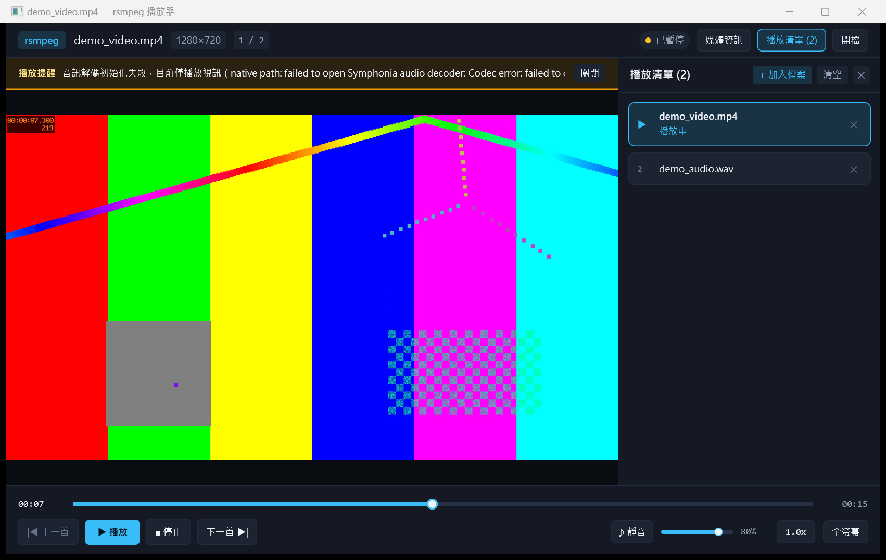
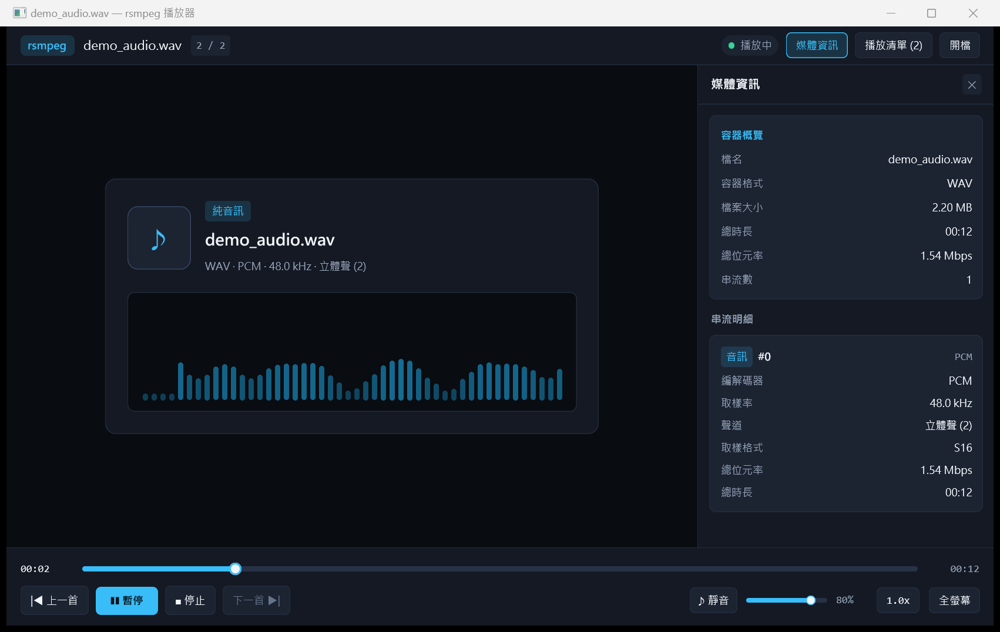

# rsmpeg-gui 桌面影音播放器使用與開發指南

`rsmpeg-gui` 是基於 [GPUI](https://gpui.rs)（Zed 的 GPU 加速桌面 UI 框架）打造的 `rsmpeg` 桌面播放器與媒體檢視工具。所有解封裝（demux）、解碼（decode）、色彩轉換（scale）與音訊輸出皆透過 `rsmpeg-player` 公開 API 在背景執行緒進行，媒體封裝分析透過 `rsmpeg::format::FormatContext` 於背景執行緒執行，確保 UI 執行緒保持流暢不卡頓。

---

## 建置與啟動

### 環境需求

- **Rust**：`rsmpeg-gui` 單獨設定 `rust-version = "1.88"`（因 `gpui 0.2.2` 採用 Rust 2024 edition 與 build script let-chains）；workspace 其他 crate 維持原有的 `rust-version = "1.75"` 不變。
- **Windows**：
  - 支援預設 `stable-x86_64-pc-windows-gnu`（MinGW/WinLibs）與 `stable-x86_64-pc-windows-msvc`。
  - **Debug 建置**：GPUI 於執行期透過系統 Direct3D 11 動態編譯 HLSL shader，無額外 SDK 工具需求。
  - **Release 建置**：`gpui 0.2.2` 的 `build.rs` 會呼叫 Windows SDK 的 `fxc.exe` 預先編譯 HLSL shader（若未在 `PATH` 或預設 Windows 10 SDK 路徑，可透過環境變數 `GPUI_FXC_PATH` 指定）。
- **Linux / macOS**：透過條件相依保留 `gpui 0.2.2` 預設 features（Wayland/X11/font-kit 或 Metal）。

### 建置與執行指令

```powershell
# 開發版建置與執行
cargo run -p rsmpeg-gui

# 啟動時直接載入單檔或多檔（自動加入播放清單並播放第一首）
cargo run -p rsmpeg-gui -- path\to\video.mp4 path\to\audio.wav

# Release 建置
cargo build --release -p rsmpeg-gui
.\target\release\rsmpeg-gui.exe path\to\video.mp4
```

### 測試與品質檢查

```powershell
cargo fmt --all -- --check
cargo clippy --workspace --all-targets -- -D warnings
cargo test --workspace
```

---

## 主要功能

1. **三種開檔方式**
   - **檔案對話框**：點擊歡迎頁「開啟媒體檔案」、頂部列「開檔」、播放清單「+ 加入檔案」或按 `O` / `Ctrl+O`（背景執行緒開啟原生多選對話框，不阻塞視窗）。
   - **拖放開檔**：直接將單個／多個檔案或資料夾拖放至視窗，自動於背景掃描媒體副檔名並加入播放清單立即播放。
   - **命令列參數**：支援 `rsmpeg-gui [FILES...]` 傳入零個、單個或多個檔案路徑。

2. **影片與純音訊顯示**
   - **影片舞台**：使用 GPUI GPU 加速 `RenderImage`（RGBA8 轉 BGRA8）搭配 `ObjectFit::Contain` 維持原始長寬比與黑色信箱區，縮放視窗流暢不卡；更換影格時主動呼叫 `window.drop_image` 釋放舊紋理避免 GPU 記憶體累積。
   - **純音訊舞台**：偵測為純音訊檔（或視訊 codec 不支援而回退純音訊播放）時，顯示封面占位圖示、檔名、容器／取樣率／聲道摘要與即時捲動波形視覺化（由 `rsmpeg-player` 節流送出的 `PlayerEvent::AudioLevel` 驅動）。

3. **播放控制列**
   - 播放／暫停（停止或播完後按播放自動重播）、停止、上一首／下一首。
   - 可點擊與跨視窗拖曳的進度列（拖曳中即時預覽目標時間，放開後定位）。
   - 等寬字型顯示目前時間與總時長（`MM:SS` 或 `HH:MM:SS`）。
   - 可拖曳音量滑桿、百分比讀數與靜音切換（記住靜音前音量，解除靜音自動還原）。
   - 播放速度切換：`0.5x`、`0.75x`、`1.0x`、`1.25x`、`1.5x`、`2.0x`（同時作用於視訊排程時鐘與 `rodio` 音訊速度）。
   - 全螢幕切換（按鈕、雙擊影片舞台或快捷鍵 `F`，按 `Esc` 退出）。

4. **媒體資訊面板（`rsmpeg` probe）**
   - 於背景執行緒呼叫 `rsmpeg::format::FormatContext::open_input` 與 `read_header()`，顯示容器格式、檔案大小、總時長、總位元率、串流數，以及每條串流的媒體類型、codec、解析度、幀率、像素格式、取樣率、聲道、取樣格式、位元率與中繼資料。

5. **播放清單**
   - 支援多檔管理、路徑去重、點擊立即切換、上一首／下一首、單筆移除、清空清單與播完自動連播下一首。

6. **錯誤處理與介面設計**
   - 不支援的格式、損毀或不存在的檔案皆顯示清楚的繁體中文錯誤卡片或可關閉提示橫幅，不會當掉或卡死 UI；清單內有下一首時可直接跳轉繼續播放。
   - 深色劇院主題、Windows 下預設採用 `Microsoft JhengHei UI` 正常顯示繁體中文與 `Consolas` 顯示等寬時間碼。
   - 所有使用者可見字串集中管理於 `rsmpeg-gui/src/i18n.rs`，方便日後擴充英文（`en-US`）或其他語系。

---

## 鍵盤快捷鍵

| 快捷鍵 | 功能 |
| --- | --- |
| `Space` | 播放／暫停 |
| `←` / `→` | 倒轉／快轉 5 秒 |
| `↑` / `↓` | 音量增加／減少 5% |
| `F` | 切換全螢幕（雙擊影片區亦可） |
| `Esc` | 退出全螢幕（非全螢幕時關閉側邊面板） |
| `M` | 靜音／取消靜音 |
| `O` 或 `Ctrl+O` | 開啟媒體檔案對話框 |
| `S` | 停止播放並歸零 |
| `N` / `PageDown` | 下一首 |
| `P` / `PageUp` | 上一首 |
| `[` / `]` | 降低／提高播放速度 |
| `I` | 開關媒體資訊面板 |
| `L` | 開關播放清單側欄 |

---

## GPUI 版本選擇與取捨

- **選用版本**：crates.io 官方 `gpui = "0.2.2"`（由 Zed Industries 發布）。
- **取捨原因**：
  - `gpui 0.2.2` 內建完整的 Windows Direct3D 11 + DirectWrite 平台後端與拖放（`IDropTarget` / `ExternalPaths`），不需額外相依社群 fork（如 `gpui-ce` 或 `gpui-unofficial`）或引入獨立 `gpui_platform` crate，API 穩定且可在預設 `x86_64-pc-windows-gnu` 工具鏈直接編譯通過。
  - 在 Windows 目標上透過 `[target.'cfg(target_os = "windows")'.dependencies]` 使用 `default-features = false, features = ["windows-manifest"]`，避免在 Windows 上拉入無用的 Linux `wayland`/`x11`/`blade-graphics` 相依，顯著縮短編譯時間，同時保留 `PerMonitorV2` HiDPI manifest 支援。
  - 代價為：在 MinGW `ld.exe` 連結時會出現一則無害的 `.rsrc merge failure: multiple non-default manifests` 連結器警告（不影響執行與 DPI 縮放，亦不影響 `clippy -D warnings`）。

---

## 實測截圖

以下截圖皆由實際啟動 `rsmpeg-gui.exe` 於 Windows Direct3D 11 視窗擷取（1702×1076 物理像素，150% DPI）：

| 畫面 | 截圖 |
| --- | --- |
| 歡迎畫面與預設深色介面 |  |
| MP4（1280×720 H.264）播放中＋媒體資訊面板 |  |
| 快轉定位至 00:07、暫停與播放清單側欄 |  |
| 純音訊 WAV 舞台、即時波形視覺化與 probe 資訊 |  |
| 損毀檔案錯誤處理畫面 |  |

---

## 已知限制

- **視訊／音訊 codec 覆蓋率取決於 `rsmpeg-player`**：目前原生視訊解碼僅支援 H.264（OpenH264）；遇到 HEVC/VP9/AV1 等未支援視訊軌會顯示提示橫幅並嘗試以純音訊模式播放。
- **原生 MP4 AAC `esds` 限制**：部分 FFmpeg 產生的 MP4 在 `rsmpeg-format` 原生 demux 路徑下 `esds` extradata 尚未完整剝離封裝標頭，可能導致原生路徑音訊解碼初始化失敗而顯示非致命提示並僅播放視訊（此屬既有 `rsmpeg-format`/`rsmpeg-player` 限制，GUI 會清楚回報而不當掉）。
- **音訊變速音高**：播放速度使用 `rodio::Sink::set_speed`，屬重採樣變速，尚未實作維持原音高（time-stretch）演算法。
- **拖放資料夾深度**：拖放資料夾時僅掃描第一層的支援媒體檔案，避免深度遞迴掃描造成延遲。
- **無頭 CI 測試範圍**：GPUI 視窗渲染本身需要圖形介面，單元測試涵蓋非 UI 核心邏輯（狀態機、時間與單位格式化、快捷鍵對應、播放清單、probe 解析、RGBA→BGRA 轉換與長寬比計算）。
