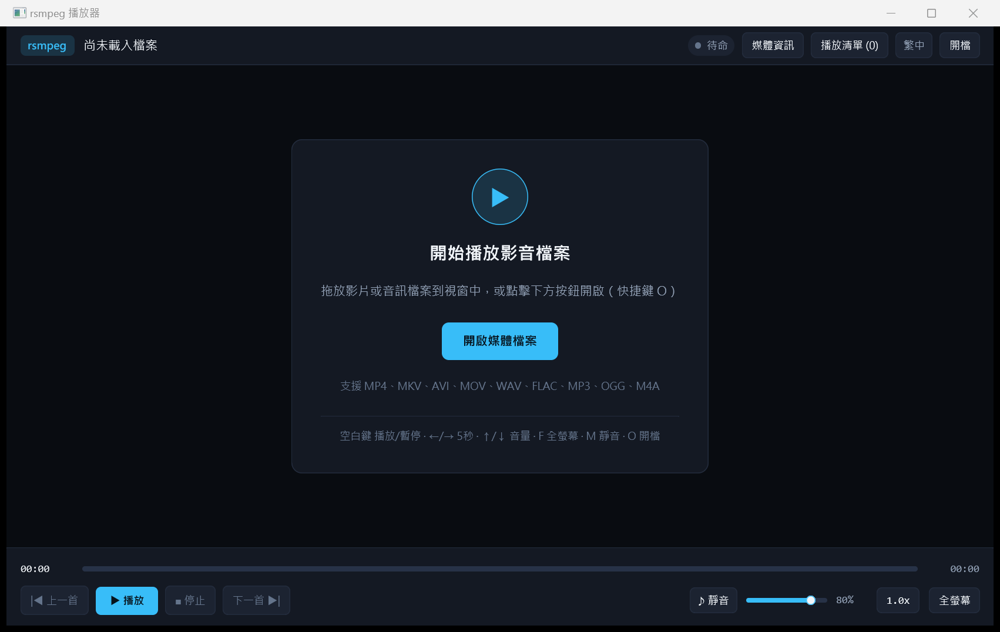
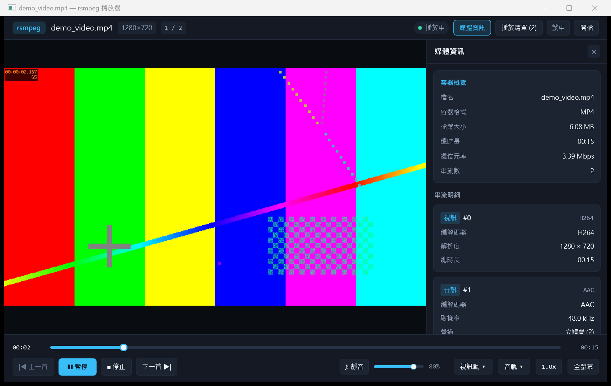
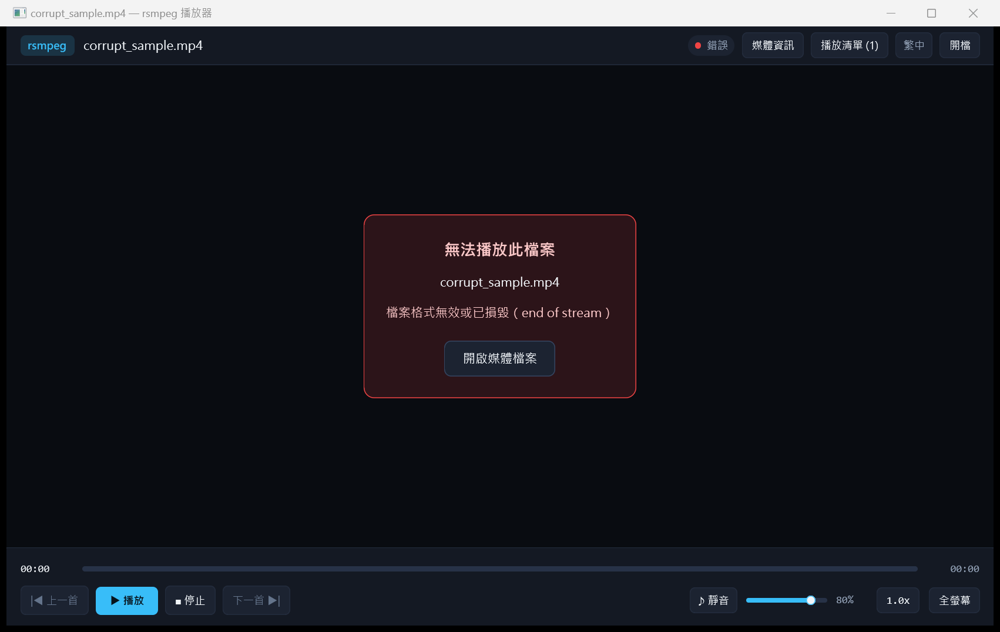
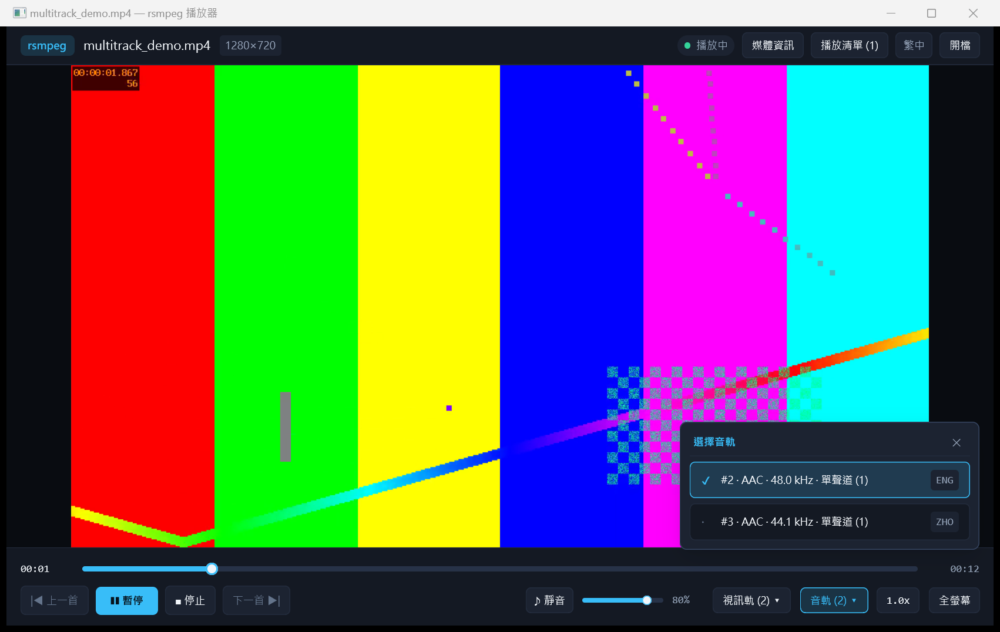
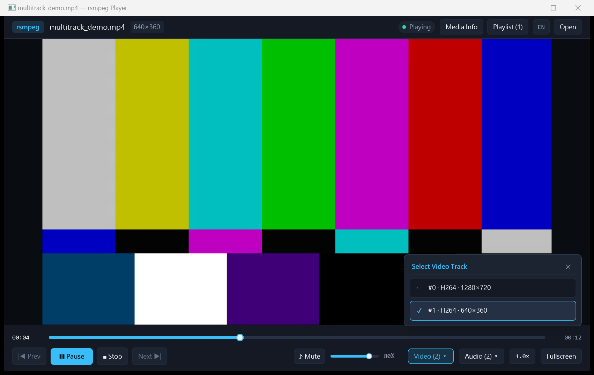

# rsmpeg-gui 桌面影音播放器使用與開發指南

`rsmpeg-gui` 是基於 [GPUI](https://gpui.rs)（Zed 的 GPU 加速桌面 UI 框架）打造的 `rsmpeg` 桌面播放器與媒體檢視工具。所有解封裝（demux）、解碼（decode）、色彩轉換（scale）與音訊輸出皆透過 `rsmpeg-player` 公開 API 在背景執行緒進行，媒體封裝分析透過 `rsmpeg::format::FormatContext` 於背景執行緒執行，確保 UI 執行緒保持流暢不卡頓。

---

## 建置與啟動

### 環境需求

- **Rust**：`rsmpeg-gui` 單獨設定 `rust-version = "1.88"`（因 `gpui 0.2.2` 採用 Rust 2024 edition 與 build script let-chains）；workspace 其他 crate 維持原有的 `rust-version = "1.75"` 不變。
- **Windows**：
  - 支援預設 `stable-x86_64-pc-windows-gnu`（MinGW/WinLibs）與 `stable-x86_64-pc-windows-msvc`。
  - **Debug 建置**：GPUI 於執行期透過系統 Direct3D 11 動態編譯 HLSL shader，無額外 SDK 工具需求。
  - **Release 建置**：`gpui 0.2.2` 的 `build.rs` 會呼叫 Windows SDK 的 `fxc.exe` 預先編譯 HLSL shader（若未在 `PATH` 或預設 Windows 10 SDK 路徑，可透過環境變數 `GPUI_FXC_PATH` 指定）。
- **Linux / macOS**：透過條件相依保留 `gpui 0.2.2` 預設 features（Wayland/X11/font-kit 或 Metal）。

### 建置與執行指令

```powershell
# 開發版建置與執行
cargo run -p rsmpeg-gui

# 啟動時直接載入單檔或多檔（自動加入播放清單並播放第一首）
cargo run -p rsmpeg-gui -- path\to\video.mp4 path\to\audio.wav

# 以英文介面啟動（支援 zh / en，執行中亦可按 G 或點擊頂部列按鈕即時切換）
cargo run -p rsmpeg-gui -- --lang en path\to\video.mp4

# Release 建置
cargo build --release -p rsmpeg-gui
.\target\release\rsmpeg-gui.exe path\to\video.mp4
```

> **Release 建置實測結果**：於 Windows `stable-x86_64-pc-windows-gnu`（搭配 Windows 10 SDK `fxc.exe` 預先編譯 GPUI HLSL shader）執行 `cargo build --release -p rsmpeg-gui` 建置通過，產出 `target\release\rsmpeg-gui.exe` 大小為 **44,106,389 bytes（約 42.06 MiB）**。

### 測試與品質檢查

```powershell
cargo fmt --all -- --check
cargo clippy --workspace --all-targets -- -D warnings
cargo test --workspace
```

---

## 主要功能

1. **多種開檔與字幕載入方式**
   - **檔案／資料夾對話框**：點擊歡迎頁「開啟媒體檔案」、頂部列「開檔」、播放清單「加入檔案」／「資料夾」或按 `O` / `Ctrl+O`（背景執行緒開啟原生對話框，不阻塞視窗）。
   - **拖放開檔與字幕**：直接將單個／多個媒體檔案或資料夾拖放至視窗，自動於背景掃描支援副檔名並加入播放清單立即播放；拖放 `.srt` / `.vtt` 字幕檔亦可直接載入目前影片。
   - **命令列參數**：支援 `rsmpeg-gui [FILES...]` 傳入零個、單個或多個檔案路徑。

2. **影片與純音訊舞台、畫面調整與截圖**
   - **影片舞台與畫面比例**：使用 GPUI GPU 加速 `RenderImage`（RGBA8 轉 BGRA8），支援切換 `Contain`（完整適應）／`Cover`（填滿裁切）／`Fill`（拉伸填滿）三種比例模式（`D` 或工具選單）；更換影格時主動呼叫 `window.drop_image` 釋放舊紋理避免 GPU 記憶體累積。
   - **非破壞性視訊調整（`VideoTransform`）**：於工具選單（`T`）內即時調整順時針旋轉 90°（`Shift+R`、`0°→90°→180°→270°`）、水平鏡像、BT.601 灰階模式、亮度（`-50..=+50`）與對比度（`50%..=150%`），並可一鍵重設。
   - **PNG 截圖**：按 `Shift+S` 或點擊工具選單「截圖」，將目前套用旋轉／濾鏡後的視訊畫面匯出為 PNG 檔。
   - **純音訊舞台**：偵測為純音訊檔（或視訊 codec 不支援而回退純音訊播放）時，顯示封面占位圖示、檔名、容器／取樣率／聲道摘要與即時捲動波形視覺化（由 `rsmpeg-player` 節流送出的 `PlayerEvent::AudioLevel` 驅動）。

3. **播放控制列、精準定位、A-B 循環與軌道切換**
   - **進度列與時間顯示**：可點擊與跨視窗拖曳的進度列，**滑鼠懸停進度列即時預覽目標時間戳記**，點擊時間碼可**切換剩餘時間／總時長**（`MM:SS` 或 `HH:MM:SS`）。
   - **多段式快轉／倒轉與逐幀步進**：支援標準快轉 ±5 秒（`←`/`→`）、長距離 ±30 秒（`Shift+←`/`→`）、精準微調 ±1 秒（`Ctrl+←`/`→`）、數字鍵 `0`–`9` 跳轉 `0%–90%` 進度，以及 `.` /「逐幀」按鈕呼叫 `Player::step_forward` 單幀前進。
   - **A-B 循環、清單循環與隨機播放**：按 `B` 或「A-B」鈕依序設定 A 點 → 設定 B 點啟用區段循環 → 清除 A-B 循環；按 `R` 切換清單循環模式（`Off` / `All` / `One`）；按 `H` 開關隨機播放。
   - **音量與 OSD 回饋**：支援音量滑桿、靜音切換（`M`，記住靜音前音量）、鍵盤 `↑`/`↓` 及**舞台滑鼠滾輪調整音量 ±5%**，搭配畫面中央即時 OSD 提示（音量、單幀步進、A-B 循環等）。
   - **視訊軌／音軌下拉選單**：由 `rsmpeg-player` 發出 `PlayerEvent::Tracks`，底部控制列動態顯示 `視訊軌`／`音軌` 下拉按鈕；展開選單列出串流編號、編解碼器、解析度或取樣率／聲道、語言標籤與支援狀態，點擊即可即時切換軌道。
   - **播放速度切換**：`0.5x`、`0.75x`、`1.0x`、`1.25x`、`1.5x`、`2.0x`（`[` / `]` 調整，`Backspace` 一鍵重設 `1.0x`）。
   - **全螢幕切換**：按鈕、雙擊影片舞台或快捷鍵 `F`，按 `Esc` 關閉彈窗／側欄或退出全螢幕。

4. **SRT / WebVTT 字幕顯示與同步控制**
   - 內建純 Rust `rsmpeg::codec::parse_subtitle_file`（`SrtCodec` / `WebVttCodec` / `SubtitleTrack`），支援 `.srt` 與 `.vtt` 字幕檔載入（`Shift+C`、工具選單或直接拖放字幕檔）。
   - 支援快捷鍵 `C` 開關字幕顯示、調整字幕時間偏移／延遲（正負毫秒微調）與字體大小（`小` / `中` / `大`）。

5. **純 Rust 解碼／解封裝管線與作用中解碼器徽章**
   - **原生純 Rust 解碼器（`rsmpeg-codec`）**：`FlacDecoder`（RFC 9639 無損 FLAC）、`MjpegDecoder`（ITU-T T.81 Baseline DCT Motion-JPEG）、`PCMAudioDecoder`（U8/S16/S32/F32）與 `RawVideoDecoder`；搭配 `OpenH264`（H.264）與 `Symphonia`（AAC/MP3/Vorbis/Opus 等）提供完整播放覆蓋。
   - **原生解封裝器（`rsmpeg-format`）**：`FLACDemuxer` 支援完整有狀態 `read_frame`（CRC-16 邊界掃描）與 `seek`（SEEKTABLE 二分搜尋／位元組估算重新同步）；`MP4Demuxer` 除了 H.264 與 `esds` AAC 外，亦完整支援 MJPEG 視訊樣本項目（`jpeg`、`mjpa`、`mjpb`、`mjpg`、`mp4v` `0x6C`）與 FLAC 音訊樣本項目（`fLaC` + `dfLa` STREAMINFO extradata）。
   - **作用中解碼引擎徽章**：介面與媒體資訊面板即時顯示 `PlayerEvent::DecoderInfo` 回報的目前解封裝器、視訊解碼器與音訊解碼器名稱。

6. **媒體資訊面板與播放清單管理**
   - **媒體資訊面板（`I`）**：於背景執行緒呼叫 `rsmpeg::format::FormatContext::open_input` 與 `read_header()`，顯示容器格式、檔案大小、總時長、總位元率、串流數、各串流詳細參數，以及目前作用中的解碼引擎資訊。
   - **播放清單側欄（`L`）**：支援加入檔案、**加入整個資料夾**、路徑去重、點擊立即切換、**上移／下移重新排序**、單筆移除、清空清單，並整合 `Off`/`All`/`One` 循環與隨機播放策略。

7. **多語系（繁體中文／英文）、快捷鍵說明與錯誤處理**
   - 內建完整 `ZH_TW`（預設）與 `EN_US` 語系表（集中管理於 `rsmpeg-gui/src/i18n.rs`），可透過頂部列 `繁中`／`EN` 按鈕、快捷鍵 `G` 或啟動參數 `--lang zh|en` 即時切換。
   - 按 `?` 或 `F1` 開啟**鍵盤與滑鼠快捷鍵說明彈窗**，按 `Esc` 關閉。
   - 不支援的格式、損毀或不存在的檔案皆顯示清楚的在地化錯誤卡片或可關閉提示橫幅，不會當掉或卡死 UI。
   - 亦可搭配命令列工具 `rsmpeg decode` 測試純 Rust 解碼輸出（如 `rsmpeg decode audio.flac -o out.wav`、`rsmpeg decode video.mp4 -o frame.ppm` 或 `rsmpeg decode subs.srt`）。

---

## 鍵盤與滑鼠快捷鍵

| 快捷鍵 / 操作 | 功能 |
| --- | --- |
| `Space` | 播放／暫停 |
| `←` / `→` | 快退／快進 5 秒 |
| `Shift + ←` / `→` | 快退／快進 30 秒 |
| `Ctrl + ←` / `→` | 精準微調 ±1 秒 |
| `0` – `9` | 跳轉至 0% – 90% 播放進度 |
| `.` | 單幀前進（Step Forward） |
| `↑` / `↓` / 滑鼠滾輪 | 音量增加／減少 5%（含 OSD 提示） |
| `M` | 靜音／取消靜音 |
| `[` / `]` / `Backspace` | 降低／提高播放速度／重設 `1.0x` |
| `B` | A-B 循環（設 A 點 → 設 B 點 → 清除） |
| `R` / `H` | 切換循環模式（關／全部／單曲）／開關隨機播放 |
| `D` / `Shift + R` | 切換畫面比例模式（Contain／Cover／Fill）／順時針旋轉 90° |
| `Shift + S` | 儲存目前畫面為 PNG 截圖 |
| `C` / `Shift + C` | 顯示或隱藏字幕／開啟字幕檔案（`.srt` / `.vtt`） |
| `V` / `A` / `T` | 開關視訊軌選單／音軌選單／工具選單 |
| `I` / `L` | 開關媒體資訊面板／播放清單側欄 |
| `F` / 雙擊畫面 | 切換全螢幕 |
| `O` / `Ctrl + O` | 開啟媒體檔案對話框 |
| `S` | 停止播放並歸零 |
| `N` / `PageDown` | 下一首 |
| `P` / `PageUp` | 上一首 |
| `G` | 即時切換介面語系（繁體中文／English） |
| `?` / `F1` | 開關鍵盤與滑鼠快捷鍵說明視窗 |
| `Esc` | 關閉選單、說明視窗、側邊面板或退出全螢幕 |

---

## GPUI 版本選擇與取捨

- **選用版本**：crates.io 官方 `gpui = "0.2.2"`（由 Zed Industries 發布）。
- **取捨原因**：
  - `gpui 0.2.2` 內建完整的 Windows Direct3D 11 + DirectWrite 平台後端與拖放（`IDropTarget` / `ExternalPaths`），不需額外相依社群 fork（如 `gpui-ce` 或 `gpui-unofficial`）或引入獨立 `gpui_platform` crate，API 穩定且可在預設 `x86_64-pc-windows-gnu` 工具鏈直接編譯通過。
  - 在 Windows 目標上透過 `[target.'cfg(target_os = "windows")'.dependencies]` 使用 `default-features = false, features = ["windows-manifest"]`，避免在 Windows 上拉入無用的 Linux `wayland`/`x11`/`blade-graphics` 相依，顯著縮短編譯時間，同時保留 `PerMonitorV2` HiDPI manifest 支援。
  - 代價為：在 MinGW `ld.exe` 連結時會出現一則無害的 `.rsrc merge failure: multiple non-default manifests` 連結器警告（不影響執行與 DPI 縮放，亦不影響 `clippy -D warnings`）。

---

## 實測截圖

以下截圖皆由實際啟動 Release 版 `rsmpeg-gui.exe` 於 Windows Direct3D 11 視窗擷取（1702×1076 物理像素，150% DPI）：

| 畫面 | 截圖 |
| --- | --- |
| 歡迎畫面與預設深色介面（含頂部列語系切換鈕） |  |
| FFmpeg MP4（1280×720 H.264 + 48 kHz AAC）原生有聲播放中（零解碼警告）＋媒體資訊面板 |  |
| 快轉定位至 00:07、暫停與播放清單側欄 |  |
| 純音訊 WAV 舞台、即時波形視覺化與 probe 資訊 |  |
| 損毀檔案錯誤處理畫面 |  |
| 多軌 MP4 音軌切換下拉選單（雙 H.264 + 雙 AAC `ENG`/`ZHO`） |  |
| EN_US 英文語系＋實測切換至視訊軌 `#1`（`640×360` SMPTE 色條）與視訊軌選單 |  |

---

## 已知限制

- **視訊／音訊 codec 覆蓋率取決於 `rsmpeg-player`**：原生視訊解碼支援 H.264（OpenH264）以及純 Rust 的 MJPEG（`MjpegDecoder`）與 RawVideo（`RawVideoDecoder`），音訊支援純 Rust 的 FLAC（`FlacDecoder`）與 PCM（`PCMAudioDecoder`）以及 Symphonia（AAC、MP3、Vorbis、Opus、ALAC 等）；遇到 HEVC/VP9/AV1 等未支援視訊軌會顯示提示橫幅並嘗試以純音訊模式播放。
- **音訊變速音高**：播放速度使用 `rodio::Sink::set_speed`，屬重採樣變速，尚未實作維持原音高（time-stretch）演算法。
- **拖放資料夾深度**：拖放或加入資料夾時僅掃描第一層的支援媒體檔案，避免深度遞迴掃描造成延遲。
- **無頭 CI 測試範圍**：GPUI 視窗渲染本身需要圖形介面，單元測試涵蓋非 UI 核心邏輯（狀態機、時間與單位格式化、快捷鍵對應、播放清單與排序／循環／隨機邏輯、probe 解析、RGBA→BGRA 轉換、視訊旋轉／濾鏡／截圖與長寬比計算）。
